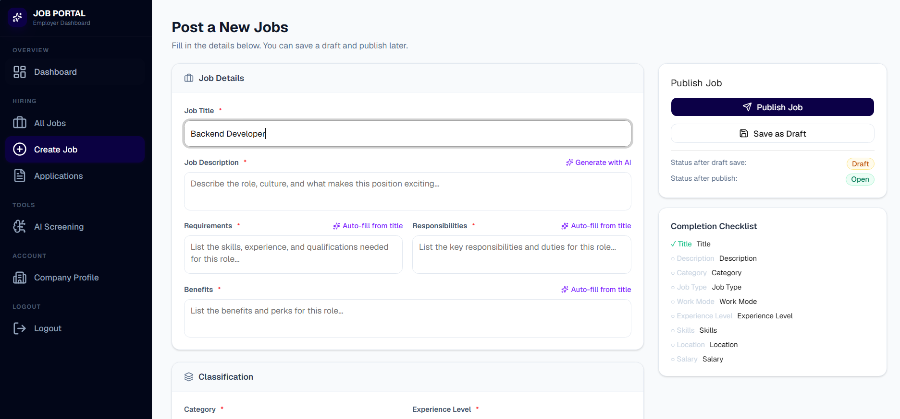
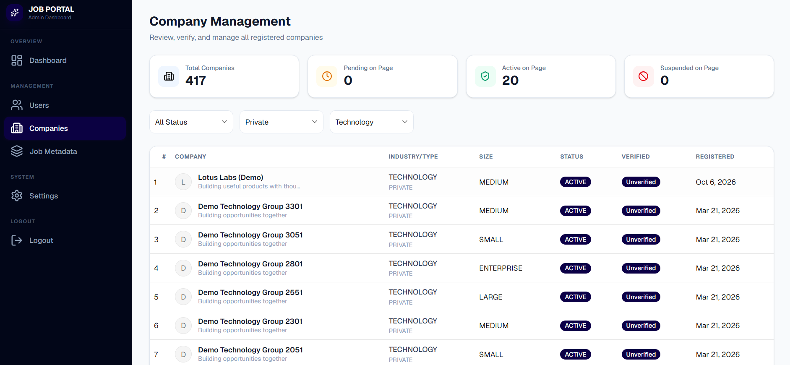

# Job Portal — Microservices Platform

An **AI-assisted Job Portal System** built with Spring Boot microservices, a React frontend, event-driven notifications, and Spring Cloud infrastructure. The platform covers the recruitment lifecycle — from job search and resume creation through applications, AI candidate screening, and hiring status updates.

---

## Table of Contents

1. [Architecture Overview](#1-architecture-overview)
2. [Features](#2-features)
3. [Services](#3-services)
4. [Data Flow](#4-data-flow)
5. [Technology Stack](#5-technology-stack)
6. [Design Patterns](#6-design-patterns)
7. [Security](#7-security)
8. [API Reference](#8-api-reference)
9. [Running the Project](#9-running-the-project)
10. [Tests](#10-tests)
11. [Configuration](#11-configuration)
12. [Known Limitations](#12-known-limitations)
13. [UI Screenshots](#13-ui-screenshots)
14. [Project Structure](#14-project-structure)

---

## 1. Architecture Overview


<details>
<summary>Text architecture diagram</summary>

```text
                    ┌──────────────────────────────────────────┐
                    │       REACT FRONTEND (Vite :5173)         │
                    └────────────────────┬─────────────────────┘
                                         │ HTTP :5000
                    ┌────────────────────▼─────────────────────┐
                    │              API GATEWAY                 │
                    │          JWT Auth · Routing · CORS       │
                    └────────────────────┬─────────────────────┘
                                         │ Eureka / Load Balancer
          ┌──────────────┬───────────────┼──────────────┬──────────────┐
          ▼              ▼               ▼              ▼              ▼
     ┌─────────┐   ┌───────────┐   ┌───────────┐  ┌───────────┐  ┌───────────┐
     │  User   │   │  Company  │   │    Job    │  │  Resume   │  │Preference │
     │ Service │   │  Service  │   │  Service  │  │  Service  │  │  Service  │
     └─────────┘   └───────────┘   └───────────┘  └───────────┘  └───────────┘
                                         │ Feign
                    ┌────────────────────▼─────────────────────┐
                    │           APPLICATION SERVICE            │
                    │  Calls User · Company · Job · Resume     │
                    └──────────┬─────────────────┬─────────────┘
                               │ Feign           │ Status-change event
                    ┌──────────▼────────┐  ┌─────▼────────────────────┐
                    │    AI SERVICE     │  │      APACHE KAFKA        │
                    │    Google Gemini  │  │application.status.changed│
                    └───────────────────┘  └─────┬────────────────────┘
                                                 ▼
                                       ┌─────────────────────────┐
                                       │  NOTIFICATION SERVICE   │
                                       │  HTML Email → MailHog   │
                                       └─────────────────────────┘

                    ┌──────────────────────────────────────────┐
                    │             INFRASTRUCTURE               │
                    │ Eureka · Config Server · PostgreSQL      │
                    │ Per-service databases · Redis Cache      │
                    └──────────────────────────────────────────┘
```

</details>

---

## 2. Features

### 2.1 For Job Seekers (Candidate-Facing)

- **Job Search** — Filter by keyword, category, skills, tags, company, location, salary, job type, work mode, experience level, status, and openings; paginate and sort results
- **Resume Builder** — Manage personal information, education, work experience, skills, projects, and languages; choose a template, visibility, and default resume
- **AI Resume Assistance** — Generate professional summaries and work experience bullet points
- **Job Applications** — Apply with a resume, cover letter, expected salary, and availability date
- **AI Application Assistance** — Generate cover letters and identify skills gaps
- **Application Management** — View submitted applications and withdraw applications
- **Saved Jobs** — Save and remove jobs from a personal shortlist
- **Status Update Emails** — Receive HTML email updates when an employer changes an application's status
- **Profile Management** — Maintain account and contact information

### 2.2 For Employers

- **Company Profiles** — Create and manage company details and social links
- **Job Management** — Create, edit, publish, close, and delete job postings
- **Job Metadata** — Associate categories, skills, and tags with postings
- **AI Job Assistance** — Generate job descriptions and suggest skills
- **Applicant Management** — Review applications by job or company, filter candidates, star applications, and add notes
- **Hiring Workflow** — Update statuses including reviewing, shortlisted, interview scheduled, rejected, and hired
- **AI Candidate Screening** — Compare resumes against job requirements, with overall and component scores, matched/missing skills, strengths, and concerns

### 2.3 For System Administrators

- **User Management** — Manage users and account status through the administration interface
- **Company Moderation** — Verify or deactivate companies
- **Job Metadata Management** — Maintain job categories, skills, and tags
- **Centralized Configuration** — Service settings loaded from a Git-backed Config Server
- **Service Discovery** — Eureka-based dynamic service registration

---

## 3. Services

### 3.1 Infrastructure Services

| Service | Port | Role |
|---|---|---|
| **API Gateway** | 5000 | Single entry point — JWT validation, routing, CORS |
| **Config Server** | 8888 | Centralized service configuration pulled from Git |
| **Service Registry** | 8761 | Eureka — service registration and discovery |
| **Kafka** | 9092 | Application status events (KRaft mode — no Zookeeper) |
| **PostgreSQL** | 5432 locally | Dedicated database per persistent business service |
| **Redis** | 6379 | Cache for company and job lookups |
| **MailHog** | SMTP 1025 / UI 8025 | Local email capture and preview |

### 3.2 Business Services

| Service | Config Port | Database | Kafka | Responsibility |
|---|---|---|---|---|
| **job-portal-user-service** | 5001 | `job_portal_user` | — | Signup/login, JWT, profiles, user administration |
| **job-portal-company-service** | 5002 | `job_portal_company` | — | Company profiles, social links, verification |
| **job-portal-job-service** | 5003 | `job_portal_job` | — | Job postings, search, categories, skills, tags |
| **job-portal-resume-service** | 5004 | `job_portal_resume` | — | Resumes and their education, experience, skills, projects, languages |
| **job-portal-application-service** | 5005 | `job_portal_application` | Producer | Applications, employer review, notes, AI screening results |
| **job-portal-preference-service** | 5006 | `job_portal_preference` | — | Candidate saved jobs |
| **job-portal-ai-service** | 6000 | — | — | Gemini-powered resume, job, search, and application assistance |
| **job-portal-notification-service** | 5011 | — | Consumer | Application status emails through SMTP |

---

## 4. Data Flow

### 4.1 Job Search

```text
Client → API Gateway → job-portal-job-service
  │
  ├─ 1. Bind query parameters to JobSearchRequest
  ├─ 2. Build JPA Specifications for the requested filters
  ├─ 3. Query PostgreSQL with pagination and sorting
  ├─ 4. Enrich each job with company details
  │       └─[Feign]→ job-portal-company-service (Redis-backed lookup)
  └─ 5. Return Page<JobResponse>
```

### 4.2 Application & AI Screening

```text
Client → API Gateway → job-portal-application-service
  │
  ├─ 1. Reject duplicate applications for the candidate and job
  ├─ 2. Validate that the job is open, active, and within its deadlines
  │       └─[Feign]→ job-portal-job-service
  ├─ 3. Fetch the candidate's selected resume
  │       └─[Feign]→ job-portal-resume-service
  ├─ 4. Save the application (status: PENDING)
  ├─ 5. Start asynchronous AI screening
  │       ├─[Feign]→ Job and Resume services (requirements and candidate data)
  │       └─[Feign]→ AI service → Google Gemini
  │                   Store scores, skills analysis, and shortlist category
  └─ 6. Return ApplicationResponse; screening completes separately

Employer → PATCH /api/applications/{id}/status
  │
  ├─ Validate employer ownership and update application status
  ├─ Enrich ApplicationStatusChangedEvent with candidate, job, and company
  └─ Publish → Kafka: application.status.changed
                       │
                       ▼
             job-portal-notification-service
                       │
                       └─ Send HTML status update email → SMTP / MailHog
```

---

## 5. Technology Stack

| Layer | Technologies | Purpose |
|---|---|---|
| Backend | Java, Spring Boot, Spring Data JPA | Microservices, persistence, and dynamic queries |
| Service infrastructure | Spring Cloud Gateway, Eureka, Config, OpenFeign, LoadBalancer | Routing, discovery, configuration, and inter-service calls |
| Data | PostgreSQL, Redis | Per-service databases and cached job/company lookups |
| Security | Spring Security, JJWT, BCrypt | Authentication, JWT validation, and password hashing |
| Messaging & email | Apache Kafka, Spring Mail, MailHog | Status-change events and HTML email delivery |
| AI | Google Gemini, Google Gen AI Java SDK | Content generation, skills analysis, and candidate screening |
| Frontend | React, Vite, Tailwind CSS, Redux Toolkit, React Router | UI, styling, state, and navigation |
| UI utilities | Axios, React Hook Form, Zod, shadcn, Radix UI, Base UI, Recharts | API requests, forms, validation, components, and charts |
| Build & testing | Maven, Jib, Docker Compose, pnpm, Node.js, k6 | Builds, containers, dependency management, and system tests |

Dependency versions are defined in the [backend POM](job-portal-system/pom.xml), [frontend manifest](job-portal-frontend/package.json), and [Compose file](docker/docker-compose.yml).

---

## 6. Design Patterns

### 6.1 Microservices Patterns

| Pattern | Where Used |
|---|---|
| **API Gateway** | Frontend API traffic routed through `job-portal-api-gateway` |
| **Service Registry** | Eureka registration and dynamic service resolution |
| **Config Server** | Service settings pulled from a Git repository on startup |
| **Database per Service** | Separate PostgreSQL databases for users, companies, jobs, resumes, applications, and preferences |

### 6.2 Data Patterns

| Pattern | Where Used |
|---|---|
| **Repository Pattern** | Spring Data repositories for persistence |
| **Specification Pattern** | `JobSpecification` and `ApplicationSpecification` for dynamic filtering |
| **DTO / Mapper** | Shared request/response DTOs in `common-lib`; service-specific payloads and mappers |
| **Cross-Service References** | IDs link applications to candidates, jobs, companies, and resumes |
| **Cache-Aside** | Spring Cache annotations on job and company reads, with eviction on mutations |

### 6.3 Event-Driven Patterns

| Pattern | Where Used |
|---|---|
| **Event-Driven Messaging** | Kafka carries `ApplicationStatusChangedEvent` |
| **Pub/Sub** | Notification service consumes `application.status.changed` |
| **Event Enrichment** | Publisher fetches candidate, job, and company details before sending |
| **Asynchronous Processing** | `screeningExecutor` runs AI screening outside the application request |

---

## 7. Security

### 7.1 Roles

| Role | Application Responsibilities |
|---|---|
| `ROLE_ADMIN` | User administration, company moderation, job metadata management |
| `ROLE_EMPLOYER` | Company profile, job postings, applicant review, hiring status updates |
| `ROLE_JOB_SEEKER` | Job search, resumes, saved jobs, personal applications |

### 7.2 JWT Authentication Flow

```text
1. POST /auth/login  { email, password }
        │
        ▼
   user-service validates credentials and active account status
        │
        ▼
   Returns jwt and user (claims: userId, email, authorities, expiry)
        │
        ▼
   Client sends: Authorization: Bearer <token>
        │
        ▼
   API Gateway validates signature + expiry
   Extracts claims → forwards as headers:
     X-User-Id, X-User-Email, X-User-Role
        │
        ▼
   Downstream controllers use forwarded identity
   Services check ownership where implemented
```

### 7.3 Endpoint Protection

| Path | Current Gateway Access |
|---|---|
| `/auth/**` | Public |
| `/api/admin/**` | JWT + `ROLE_ADMIN` |
| `PATCH /api/companies/{id}/verify`, `PATCH /api/companies/{id}/deactivate` | JWT + `ROLE_ADMIN` |
| `/api/users/**`, `/api/companies/**` | JWT required |
| `/api/jobs/**`, `/api/job-categories/**`, `/api/job-skills/**`, `/api/job-tags/**` | JWT required |
| `/api/resumes/**`, `/api/applications/**`, `/api/preferences/**`, `/api/ai/**` | JWT required |

---

## 8. API Reference

Send `Authorization: Bearer <token>` for protected endpoints.

| Method | Endpoint | Purpose |
|---|---|---|
| POST | `/auth/signup` | Register a job seeker or employer |
| POST | `/auth/login` | Obtain a JWT |
| GET | `/api/jobs` | Search jobs with filters and pagination |
| POST | `/api/resumes` | Create a resume |
| POST | `/api/applications` | Apply for a job using an owned resume |
| GET | `/api/applications/my` | List your applications |
| PATCH | `/api/applications/{id}/status` | Update hiring status and trigger an email notification |

See the [API examples](docs/api/README.md) for request payloads, search parameters, and response shapes. See [Security](#7-security) for gateway access rules.

---

## 9. Running the Project

### 9.1 Prerequisites

- Java 25
- Maven 3.9+
- Docker + Docker Compose
- Node.js compatible with Vite 8 and pnpm
- A Gemini API key for AI features

### 9.2 Quick Start (Docker Compose)

Run from the repository root in PowerShell:

```powershell
# Create docker/.env with a database password and Gemini API key
Set-Content -Path docker/.env -Value @('DB_PASSWORD=replace-with-your-local-password', 'GEMINI_API_KEY=your-gemini-api-key')

# Build and install the backend modules
mvn -f job-portal-system/pom.xml clean install -DskipTests

# Build local service images (Docker must be running)
mvn -f job-portal-system/pom.xml -pl cloud/job-portal-config-server,cloud/job-portal-service-registry,cloud/job-portal-api-gateway,services/job-portal-user-service,services/job-portal-company-service,services/job-portal-job-service,services/job-portal-resume-service,services/job-portal-application-service,services/job-portal-preference-service,services/job-portal-ai-service,services/job-portal-notification-service compile com.google.cloud.tools:jib-maven-plugin:3.5.2:dockerBuild -Djib.from.image=eclipse-temurin:25-jre -DskipTests

# Start the stack with local images
docker compose --env-file docker/.env -f docker/docker-compose.yml -f docker/docker-compose.local.yml up -d
docker compose --env-file docker/.env -f docker/docker-compose.yml -f docker/docker-compose.local.yml ps
```

The Config Server needs access to its configured Git repository. Building JARs alone does not update Docker images; include both Compose files in subsequent commands to use local images.

To use published images, skip the Maven commands and omit the local override:

```powershell
docker compose --env-file docker/.env -f docker/docker-compose.yml pull
docker compose --env-file docker/.env -f docker/docker-compose.yml up -d
```

The API is available at [http://localhost:5000](http://localhost:5000), Eureka at [http://localhost:8761](http://localhost:8761), and captured email at [http://localhost:8025](http://localhost:8025). Compose does not include the frontend.

### 9.3 Local Development (individual services)

```powershell
# Start local Kafka, Redis, and MailHog
docker compose -f docker/docker-compose.dev.yml up -d

# Build backend modules once
mvn -f job-portal-system/pom.xml clean install -DskipTests

# Start the registry in a separate terminal
mvn -f job-portal-system/cloud/job-portal-service-registry/pom.xml spring-boot:run

# Start required business services and gateway in separate terminals
# Set these in each service terminal to use local configuration
$env:SPRING_CLOUD_CONFIG_ENABLED = 'false'
$env:DB_PASSWORD = 'replace-with-your-local-password'
# Also set $env:GEMINI_API_KEY in the AI service terminal
# Example: application service
mvn -f job-portal-system/services/job-portal-application-service/pom.xml spring-boot:run

# Start the frontend in another terminal
cd job-portal-frontend
pnpm install
pnpm dev
```

The development Compose file provides Kafka, Redis, and MailHog. Run PostgreSQL separately and create `job_portal_user`, `job_portal_company`, `job_portal_job`, `job_portal_resume`, `job_portal_application`, and `job_portal_preference`. Datasource defaults are `localhost:5432`, user `postgres`, password `admin`; set `DB_PASSWORD` to your local password. Start all services needed by your workflow, including AI for screening.

Local Java processes do not load `docker/.env`; set environment variables in each terminal. To use Config Server, start it separately and omit `SPRING_CLOUD_CONFIG_ENABLED=false`.

The frontend runs at [http://localhost:5173](http://localhost:5173) and defaults to gateway `http://localhost:5000`. For another gateway, copy `job-portal-frontend/.env.example` to `.env.local`, set `VITE_API_URL`, and restart the dev server. Set it before `pnpm build` for deployment.

### 9.4 Environment Variables

```env
# Full Compose stack — database password
DB_PASSWORD=replace-with-your-local-password

# AI service — Compose forwards this from docker/.env; export it for local Java runs
GEMINI_API_KEY=your-gemini-api-key

# Local Java services — optional infrastructure overrides
SPRING_CLOUD_CONFIG_ENABLED=false
SPRING_DATASOURCE_USERNAME=postgres
# SPRING_DATASOURCE_URL=jdbc:postgresql://localhost:5432/job_portal_application
EUREKA_CLIENT_SERVICEURL_DEFAULTZONE=http://localhost:8761/eureka/
KAFKA_BOOTSTRAP_SERVERS=localhost:9092
SPRING_DATA_REDIS_HOST=localhost
SPRING_DATA_REDIS_PORT=6379

# Notification service — local SMTP defaults
MAIL_HOST=localhost
MAIL_PORT=1025
MAIL_FROM=no-reply@job-portal.local
```

Compose uses SMTP `mailhog:1025`; set `APP_MAIL_FROM` in Compose to change the sender. External SMTP requires Spring Mail credentials, authentication, and TLS settings.

---

## 10. Tests

The recorded tests were run on a machine with a **2-core CPU and 8 GB of RAM**.

Start the backend and required infrastructure, then run the smoke suite before cache or stress testing. The smoke suite creates its own fixtures; seed mock data for cache and stress tests. Run the commands below from the repository root in PowerShell unless noted otherwise.

### 10.1 Populate Mock Data Before Testing

The recorded VPS was seeded in two stages:

1. [General seed](docs/vps/seeding/seed-vps-scale.py): back up databases, reserve IDs, insert users → companies → resumes → jobs → applications, then verify relationships and counts. The run reached **10,000 users, 2,000 companies, 50,000 jobs, 50,000 applications, and 8,000 resumes**. Existing categories, skills, and tags are required; synthetic users are inactive.
2. [Shortlist seed](docs/vps/seeding/seed-vps-shortlist.py): add an active test employer, a dedicated company, 30 open jobs, and **239,970 pending applications** using existing candidates and resumes.

Initial commands on the recorded VPS:

```bash
python3 /root/job-portal-scale/docs/seed-vps-scale.py
python3 /root/seed-vps-shortlist.py
```

These scripts insert directly into PostgreSQL without AI screening, Kafka events, or emails. They depend on the recorded VPS schema, container names, and dataset. Keep backups and manifests: use `--verify-only` for an existing general seed or `--resume` for recovery. Shortlist reruns do not reset statuses. See the [general](docs/vps/seeding/vps-scale-seeding.md) and [shortlist](docs/vps/seeding/vps-shortlist-seeding.md) seeding reports for details.

### 10.2 Smoke Test

Runs a sequential recruitment journey through the gateway: accounts, company/job setup, resumes, search, saved jobs, applications, real Gemini generation/screening, Kafka/MailHog email delivery, and authorization checks. Requires an active admin account, working Gemini and notification services, and Node.js 22+ or Docker.

Run on the VPS:

```bash
bash docs/tests/system-smoke/run-vps.sh
```

Defaults: gateway `http://127.0.0.1:5000`, MailHog `http://127.0.0.1:8025`. Add `--preflight` for infrastructure checks. Reports and recovery manifests are saved to `docs/tests/system-smoke/results/<run-id>/`; exit codes are `0` (pass), `1` (failure), and `2` (blocked). The suite attempts fixture cleanup; missing AI results or matching emails prevent a pass.

See the [smoke suite guide](docs/tests/system-smoke/README.md) for remote PowerShell setup, cleanup recovery, and offline runner verification.

[Recorded results](docs/tests/system-smoke/DEPLOYMENT-REPORT.md): **two live runs passed, with 464/464 and 462/462 assertions**, including real AI screening and Kafka/MailHog email delivery; both had zero cleanup leftovers or uncertain mutations.

### 10.3 Cache Test

Measures company and job detail reads, first across up to 1,000 distinct IDs, then repeated reads for 20 seconds. The recorded controlled run targeted **150 RPS per phase**. Checks response IDs and unchanged payloads.

```powershell
$env:BASE_URL = 'http://localhost:5000'
$env:RPS = '150'
$env:PRECISE_SCHEDULING = 'yes'
# Optional: set API_TOKEN, or TEST_EMAIL and TEST_PASSWORD
node 'docs/tests/cache-performance/cache-performance.cjs'
```

[Controlled results](docs/tests/cache-performance/cache-performance-report.md):

| Endpoint | p50 latency reduction | p95 latency reduction | p99 latency reduction |
|---|---:|---:|---:|
| Company detail | 1.26% | 36.65% | 55.76% |
| Job detail | 17.79% | 50.57% | 49.92% |

Warmed company reads reduced **p50 by 1.26%, p95 by 36.65%, and p99 by 55.76%**; warmed job reads reduced **p50 by 17.79%, p95 by 50.57%, and p99 by 49.92%**. Across **8,000 measured requests** (1,000 cold and 3,000 warm per endpoint), there were **0 response/correctness errors** and **0 dropped arrivals**. Percentages compare end-to-end cold and warm timings using `(cold − warm) / cold × 100`, calculated from unrounded measurements.

### 10.4 Stress Test

Updates distinct seeded applications from `PENDING` to `SHORTLISTED` and checks the Kafka/MailHog pipeline. k6 ramps through **5–320 virtual users**, with a 10-second ramp and 30-second hold per level (**280 seconds**). Thresholds: **p95 <500 ms, p99 <1,000 ms, success >99.9%**.

[Recorded results](docs/tests/shortlist-stress/ramping-vus.md) and [run data](docs/tests/shortlist-stress/ramping-vus.json):

| Virtual users | Successful requests/s | p95 | p99 | Hold thresholds |
|---|---:|---:|---:|---|
| 5 | 40.13 | 155.25 ms | 193.94 ms | Pass |
| 10 | 106.93 | 120.80 ms | 159.61 ms | Pass |
| 20 | 250.70 | 122.60 ms | 163.08 ms | Pass |
| 40 | 335.27 | 204.12 ms | 257.61 ms | Pass |
| 80 | 356.23 | 342.64 ms | 423.99 ms | Pass |
| 160 | 332.97 | 702.14 ms | 775.52 ms | Fail |
| 320 | 320.37 | 1,391.70 ms | 1,675.26 ms | Fail |

Highest passing throughput: **356.23 RPS at 80 users**, with **p95 342.64 ms** and **p99 423.99 ms**. The full **280-second profile** completed; all **68,826 requests** succeeded, with **0 failures, timeouts, or server 5xx responses**. After notification drain, aggregate counts matched at **68,826 database updates, Kafka events, and captured emails**, and final Kafka lag was **0**. 

The [preserved scripts](docs/tests/shortlist-stress/scripts/) require the setup in the report, private employer credentials, new artifact directories, and enough pending fixtures. Kafka, notification-service, and MailHog must be running.

### 10.5 Unit and Controller Tests

```powershell
mvn -f job-portal-system/pom.xml test
```

---

## 11. Configuration

All service configuration is managed by the **Config Server** which pulls from:

```text
<https://github.com/hduong02/job-portal-config>
```

Each service bootstraps with:

```yaml
spring:
  config:
    import: optional:configserver:<http://localhost:8888>
```

`optional:` means if the Config Server is unavailable, the service falls back to its local `application.yaml`.

---

## 12. Known Limitations

| Limitation | Impact | Workaround |
|---|---|---|
| AI screening is asynchronous and provider-dependent | Initial application responses may lack scores; provider failures leave screening incomplete | Inspect application-service and AI-service logs; retry screening through a trusted service connection |
| Status updates and Kafka publishing are separate operations | Publisher failures can leave a saved status without a notification event | Add durable event delivery, such as an outbox, and monitor failures |
| Kafka is a single broker | No broker redundancy in local Compose | Use a replicated broker deployment when required |
| Job response enrichment calls company-service per job | Search latency depends on company-service and page size | Keep pages bounded and use the existing company cache |

---

## 13. UI Screenshots

### 13.1 Job Seeker


### 13.2 Employer



### 13.3 Admin



---

## 14. Project Structure

```text
Job Portal System/
├── job-portal-system/                        # Maven backend
│   ├── pom.xml                               # Parent POM — version management
│   ├── common-lib/                           # Shared enums, DTOs, events
│   │   └── src/main/java/com/example/
│   │       ├── domain/                       # Shared domain enums
│   │       ├── dto/
│   │       │   ├── request/                  # Shared request DTOs
│   │       │   └── response/                 # Shared response DTOs
│   │       └── event/                        # ApplicationStatusChangedEvent
│   ├── cloud/                                # Infrastructure services
│   │   ├── job-portal-api-gateway/            # Routing + JWT
│   │   ├── job-portal-config-server/          # Spring Cloud Config Server
│   │   └── job-portal-service-registry/       # Eureka Server
│   └── services/                             # Business microservices
│       ├── job-portal-user-service/
│       ├── job-portal-company-service/
│       ├── job-portal-job-service/
│       ├── job-portal-resume-service/
│       ├── job-portal-application-service/
│       ├── job-portal-preference-service/
│       ├── job-portal-ai-service/
│       └── job-portal-notification-service/
├── docker/                                   # Full stack + dev infrastructure
│   ├── docker-compose.yml
│   ├── docker-compose.dev.yml
│   └── README.md                             # Local email preview guide
├── job-portal-config/                        # Service YAML configuration
├── job-portal-frontend/                      # React + Vite frontend
├── docs/
│   ├── architecture/                       # Architecture PNG and SVG
│   ├── images/                             # UI screenshots
│   ├── tests/                              # Smoke, cache, and shortlist stress tests
│   └── vps/                                # Seeding and notification maintenance
└── README.md
```

---

*Built with Spring Boot 4.1.1 · Spring Cloud 2025.1.2 · Apache Kafka 4.3.1 · PostgreSQL 16 · React 19 · Google Gemini*
